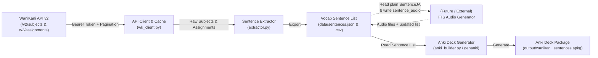

# WaniKani Vocabulary Context Sentences to Anki Exporter — Implementation Plan

## Goal Description
Build a Python CLI application (`wanikani-exporter`) that connects to the [WaniKani API v2](https://docs.api.wanikani.com/20170710/) to download vocabulary items and their context sentences, saves the extracted sentence list in structured local files (`JSON` / `CSV`), and converts that sentence list into an Anki deck package (`.apkg`) with one card per context sentence.

The exported sentence list and Anki note model are designed to be **TTS-ready** so that sentence audio can be added in the future (either via Anki add-ons like HyperTTS/AwesomeTTS, Anki's native `{{tts}}` filter, or an external script that populates audio files) without breaking existing cards or requiring template redesigns.

---

## Architecture & Data Flow



### Key WaniKani API v2 Details
1. **Authentication**: Bearer token via `Authorization: Bearer <WANIKANI_API_TOKEN>` header (loaded from `--api-token` CLI flag, `WANIKANI_API_TOKEN` environment variable, or `.env` file) and header `Wanikani-Revision: 20170710`.
2. **Vocabulary Subjects Endpoint**:
   - `GET https://api.wanikani.com/v2/subjects?types=vocabulary,kana_vocabulary`
   - Optional query parameter `levels=1,2,...` to filter by specific WaniKani levels.
   - Returns paginated collections (`1000` items per page max) with `pages.next_url`.
   - Relevant payload fields inside `data`:
     - `characters`: The vocabulary word in kanji/kana (e.g., `一`).
     - `level`: WaniKani level (`1`–`60`).
     - `meanings`: Array of `{ "meaning": str, "primary": bool, "accepted_answer": bool }`.
     - `readings`: Array of `{ "reading": str, "primary": bool, "accepted_answer": bool }` (present on `vocabulary`; `kana_vocabulary` uses `characters` directly).
     - `parts_of_speech`: Array of strings (e.g., `["noun", "numeral"]`).
     - `context_sentences`: Array of `{ "en": str, "ja": str }`.
     - `document_url`: Permalink to the WaniKani vocabulary page.
3. **User Assignments Endpoint (Optional Filtering)**:
   - `GET https://api.wanikani.com/v2/assignments?subject_types=vocabulary,kana_vocabulary`
   - Supports filtering by `unlocked=true`, `started=true`, or `srs_stages=1,2,3,4,5,6,7,8,9` so users can export only vocabulary they have unlocked or studied.
4. **Rate Limiting & Caching**:
   - WaniKani enforces a limit of **60 requests per minute**. The client will inspect `RateLimit-Remaining` and `RateLimit-Reset` headers (and retry on HTTP `429`) and cache raw responses locally using `updated_after` incremental syncs.

---

## Future TTS Audio Accommodation

Although this tool will **not** generate or fetch TTS audio itself, the data pipeline and Anki note model will accommodate future TTS workflows in four ways:

1. **Deterministic `sentence_id` (`wk_<subject_id>_<sentence_index>`)**:
   - Every exported sentence record in `sentences.json` / `sentences.csv` and every Anki note includes a stable `SentenceID` (e.g., `wk_2467_0`).
   - A future external TTS script can iterate over `sentences.json`, generate `wk_2467_0.mp3` (e.g. via VOICEVOX, Google TTS, or ElevenLabs), and set `sentence_audio` to `[sound:wk_2467_0.mp3]`.
2. **Dedicated `SentenceAudio` Field on the Anki Note Model**:
   - The Anki note model includes a `SentenceAudio` field (empty by default).
   - The card template wraps it in Anki's conditional block:
     ```html
     {{#SentenceAudio}}<div class="sentence-audio">{{SentenceAudio}}</div>{{/SentenceAudio}}
     ```
   - While empty, nothing is rendered on the card. When populated later—either via Anki add-ons like **HyperTTS / AwesomeTTS** directly inside Anki, or by re-running `wk-export build-deck` after an external tool fills `sentence_audio`—the audio player appears automatically without changing the note type.
3. **Strictly Plain-Text `SentenceJA` Field**:
   - `SentenceJA` is kept 100% free of HTML tags (any target-word highlighting markup lives exclusively in `SentenceJAHighlighted`). This ensures TTS engines or Anki's native `{{tts ja_JP:SentenceJA}}` tag can read `SentenceJA` cleanly without choking on HTML tags.
4. **Optional `--media-dir` Pass-Through in `build-deck`**:
   - `wk-export build-deck` will support an optional `--media-dir` flag. If provided in the future, any audio filenames referenced in `sentence_audio` (e.g., `[sound:wk_2467_0.mp3]`) found in that directory will be bundled into `Package.media_files` inside the `.apkg`.

---

## User Review Required

> [!IMPORTANT]
> **Two-Step Decoupled Workflow**:
> The CLI is structured so the **downloaded sentence list** (`data/sentences.json` and `data/sentences.csv`) is a first-class artifact on disk. You can run:
> - `wk-export download` to fetch from WaniKani and write the sentence list.
> - `wk-export build-deck` to generate the `.apkg` Anki deck from the saved sentence list (without needing to hit the API again).
> - `wk-export all` to run both steps end-to-end.

> [!NOTE]
> **Idempotent Anki Re-imports**:
> Each Anki note GUID will be deterministically derived from `sentence_id` (`wk_<subject_id>_<sentence_index>`) using `genanki.guid_for(...)`. Re-running the exporter with additional levels, newly unlocked words, or future TTS audio and importing the resulting `.apkg` into Anki will seamlessly add new cards and update existing ones without resetting your Anki review history.

---

## Proposed Changes

### Project Configuration & Dependencies

#### [NEW] [pyproject.toml](file:///home/xavysg/projects/wanikani-exporter/pyproject.toml)
Defines package metadata, dependencies (`requests`, `genanki`, `python-dotenv`), dev dependencies (`pytest`, `responses`), and the CLI entry point `wk-export = "wanikani_exporter.cli:main"`.

#### [NEW] [.gitignore](file:///home/xavysg/projects/wanikani-exporter/.gitignore)
Ignores `.venv/`, `__pycache__/`, `.env`, cached API data (`data/`), and generated `.apkg` files (`output/`).

#### [NEW] [.env.example](file:///home/xavysg/projects/wanikani-exporter/.env.example)
Template showing `WANIKANI_API_TOKEN=your_api_v2_token_here`.

---

### Core Package (`src/wanikani_exporter/`)

#### [NEW] [models.py](file:///home/xavysg/projects/wanikani-exporter/src/wanikani_exporter/models.py)
Data models using `@dataclass`:
```python
@dataclass
class VocabSentenceRecord:
    sentence_id: str          # Deterministic ID, e.g. "wk_2467_0" (used for GUID & future TTS filenames)
    subject_id: int
    sentence_index: int
    characters: str
    primary_reading: str
    all_readings: list[str]
    primary_meaning: str
    all_meanings: list[str]
    parts_of_speech: list[str]
    level: int
    sentence_ja: str          # Pure plain text (no HTML) for clean TTS consumption
    sentence_en: str
    document_url: str
    srs_stage: int | None = None
    sentence_audio: str = ""  # Reserved for future TTS "[sound:wk_2467_0.mp3]" tag
```

#### [NEW] [wk_client.py](file:///home/xavysg/projects/wanikani-exporter/src/wanikani_exporter/wk_client.py)
Handles communication with `https://api.wanikani.com/v2`:
- Pagination loop following `pages.next_url`.
- Automatic backoff on HTTP `429 Too Many Requests` using `RateLimit-Reset`.
- Local cache support (`data/raw_subjects_cache.json`) with incremental updates via `updated_after`.
- Methods:
  - `fetch_vocabulary_subjects(levels: list[int] | None = None, use_cache: bool = True) -> list[dict]`
  - `fetch_assignments(min_srs_stage: int | None = None, unlocked_only: bool = False) -> dict[int, dict]`

#### [NEW] [extractor.py](file:///home/xavysg/projects/wanikani-exporter/src/wanikani_exporter/extractor.py)
Transforms raw WaniKani subject + assignment payloads into flat `VocabSentenceRecord` items and exports/loads the sentence list:
- Extracts primary/secondary readings and meanings (handling both `vocabulary` and `kana_vocabulary`).
- Flattens `data.context_sentences` so each context sentence becomes a `VocabSentenceRecord` with `sentence_id = f"wk_{subject_id}_{idx}"`.
- Preserves any existing `sentence_audio` values if re-exporting over an already-enriched sentence list.
- Writes and reads:
  - JSON (`data/sentences.json`)
  - UTF-8 CSV (`data/sentences.csv`)

#### [NEW] [anki_builder.py](file:///home/xavysg/projects/wanikani-exporter/src/wanikani_exporter/anki_builder.py)
Builds the Anki `.apkg` deck from a list of `VocabSentenceRecord` items using `genanki`:
- **Custom Note Model (`WaniKani Context Sentence Model`)** with fixed `model_id`:
  - Fields (11 total):
    1. `SentenceID` (Deterministic key e.g. `wk_2467_0`)
    2. `SentenceJA` (Plain Japanese context sentence — clean input for TTS)
    3. `SentenceJAHighlighted` (Japanese sentence with target vocabulary highlighted)
    4. `SentenceEN` (English translation)
    5. `SentenceAudio` (Reserved for future `[sound:...]` tag; empty by default)
    6. `Vocabulary` (Target vocabulary characters)
    7. `Reading` (Kana reading)
    8. `Meaning` (English meanings)
    9. `PartsOfSpeech`
    10. `Level` (WaniKani level)
    11. `DocumentURL` (Link to WaniKani item page)
- **Card Template (One Card per Context Sentence)**:
  - **Front**: Clean Japanese typography displaying `{{SentenceJAHighlighted}}` (or `{{SentenceJA}}`) and a subtle level tag.
  - **Back**: `{{FrontSide}}` divider, optional `{{#SentenceAudio}}<div class="sentence-audio">{{SentenceAudio}}</div>{{/SentenceAudio}}`, English sentence translation (`{{SentenceEN}}`), and a vocabulary breakdown box showing `{{Vocabulary}}` 【`{{Reading}}`】 — `{{Meaning}}` (`{{PartsOfSpeech}}`) with a clickable link to WaniKani.
- **Media Packaging**:
  - If `--media-dir` is supplied and `record.sentence_audio` references a file in that folder, attaches the file to `genanki.Package.media_files`.
- **Deck Organization**:
  - Configurable single deck (e.g. `WaniKani Context Sentences`) or hierarchical subdecks by level (`WaniKani Context Sentences::Level 01`, etc.) via `--group-by-level`.
- **Tags**: `wanikani`, `wk::level::01`, etc.

#### [NEW] [cli.py](file:///home/xavysg/projects/wanikani-exporter/src/wanikani_exporter/cli.py)
Command-line interface using `argparse` with three subcommands:
1. `wk-export download`:
   - `--api-token`: WaniKani v2 token (falls back to `WANIKANI_API_TOKEN`).
   - `--levels`: Optional level filter (e.g. `1-10` or `1,2,3`).
   - `--unlocked-only`: Only include vocabulary unlocked by the user.
   - `--min-srs-stage`: Minimum SRS stage (`1` = Apprentice 1, `5` = Guru 1, etc.).
   - `--json-out`: Path for JSON sentence list (default: `data/sentences.json`).
   - `--csv-out`: Path for CSV sentence list (default: `data/sentences.csv`).
   - `--no-cache`: Force full re-download from WaniKani API.
2. `wk-export build-deck`:
   - `--input`: Path to `data/sentences.json` or `data/sentences.csv`.
   - `--output`: Output `.apkg` path (default: `output/wanikani_sentences.apkg`).
   - `--deck-name`: Base deck name (default: `WaniKani Context Sentences`).
   - `--group-by-level`: Organize cards into subdecks by WaniKani level.
   - `--highlight-vocab`: Bold/highlight the target vocabulary word on the front of the card when matched.
   - `--media-dir`: Optional directory containing audio files referenced by `sentence_audio` for future TTS bundling.
3. `wk-export all`:
   - Runs `download` followed immediately by `build-deck`.

---

## Verification Plan

### Automated Tests
Unit tests will be placed in `tests/` and run with `pytest`:
- `tests/test_wk_client.py`: Mock WaniKani `/v2/subjects` and `/v2/assignments` endpoints (including multi-page `pages.next_url` responses and `429` rate limit retry).
- `tests/test_extractor.py`: Verify parsing of standard `vocabulary` and `kana_vocabulary` subjects, deterministic `sentence_id` generation, preservation of `sentence_audio` across re-exports, SRS filtering, and round-trip serialization to JSON and CSV.
- `tests/test_anki_builder.py`: Verify `.apkg` creation, deterministic note GUID generation, 11-field population (including empty/populated `SentenceAudio`), optional `--media-dir` bundling, and level subdeck creation.

Command to execute automated tests:
```bash
pytest -v
```

### Manual Verification
1. Set `WANIKANI_API_TOKEN` in `.env` or pass `--api-token`.
2. Run `wk-export all --levels 1-3` to download levels 1–3 vocabulary sentences and build `output/wanikani_sentences.apkg`.
3. Inspect `data/sentences.json` and `data/sentences.csv` to verify the extracted Japanese/English sentence pairs, `sentence_id`, and empty `sentence_audio` field.
4. Import `output/wanikani_sentences.apkg` into Anki Desktop and verify card styling, fields, and tags.
